# Build Log — IoT Cyber Range

This file tracks every development step chronologically, with screenshots
as evidence, stored in `screenshots/`.

---

## Step 1: Repository structure

**What was done:**
Created the base repo structure to organize the project from day one:

iot-cyber-range/
esp32/
badge-controller/
motion-sensor/
lock-actuator/
Broker/
Backend/
screenshots/
docker-compose.yml
README.md
Notes.md


*Figure 1 — IoT Cyber Range project structure*

**Next:** write `mosquitto.conf` and `acl.conf`.

---

## Step 1 (cont.): Mosquitto broker configuration

**What was done:**
Wrote `Broker/mosquitto.conf`:
- Listener on port `1883`
- Protocol: `mqtt`
- References `acl.conf` for access control
- `allow_anonymous true` — set temporarily for development, flagged in
  Known Issues below for hardening before the final demo


*Figure 2 — Mosquitto MQTT broker configuration*

**Next:** write the ACL rules.

---

## Step 2: MQTT access control (ACL)

**What was done:**
Wrote `Broker/acl.conf` defining per-device permissions:
- `badge-controller` (ESP32 #1): publish-only on `facility/badge1/#`
- `motion-sensor` (ESP32 #2): publish-only on `facility/zone2/#`
- `lock-actuator` (ESP32 #3): subscribe-only on `facility/lock3/cmd`
- `backend`: subscribe-only on `facility/#` (wildcard, read-only)


*Figure 3 — MQTT access control rules*

**Note:** these rules were written but not yet fully enforceable with
confidence at this point, since `allow_anonymous true` was still active in
the broker config — see Known Issues (now resolved, see Step 4 cont. below).

**Later change:** the topic names in this step were revised once the lab was
built — the motion sensor uses `facility/motion1/#` and the lock uses
`facility/lock1/cmd` (see Step 7).

**Next:** add Mosquitto as a service in `docker-compose.yml` and test it.

---

## Step 3: Mosquitto running in Docker

**What was done:**
- Added a `mosquitto` service to `docker-compose.yml`:
  - `image: eclipse-mosquitto:2`
  - mounted `Broker/mosquitto.conf` and `Broker/acl.conf` as volumes
  - exposed port `1883:1883`
- Ran `docker compose up` and confirmed the broker starts without errors


*Figure 4 — Mosquitto broker running inside a Docker container*


*Figure 5 — Successful Mosquitto broker initialization*

**What was tested:**
- Verified pub/sub locally with `mosquitto_pub` / `mosquitto_sub` against
  the Dockerized broker — messages published were correctly received


*Figure 6 — Successful MQTT communication between a device and the backend*

- Verified ACL enforcement: a client identified as `badge1` was correctly
  **blocked** from publishing to `facility/lock3/cmd` (the lock actuator's
  command topic), confirming per-device topic restrictions are working


*Figure 7 — ACL preventing badge1 from publishing to the lock actuator topic*

**Later change:** the lock command topic was renamed `facility/lock1/cmd`
(Step 7); the test above used the earlier name.

**Next:** expose the broker publicly so Wokwi's simulated ESP32 devices can
reach it, then write the first ESP32 sketch (badge-controller).

---

## Step 4: Public tunnel via bore.pub (ngrok alternative)

**Context:** ngrok's free tier now requires a credit/debit card to open TCP
tunnels (ERR_NGROK_8013). Since the project must remain 100% free with no
payment info, we switched to bore (https://github.com/ekzhang/bore), an
open-source TCP tunnel client using the public bore.pub relay server.

**What was done:**
- Downloaded bore v0.6.0 prebuilt Windows binary from the official GitHub
  releases page, extracted bore.exe

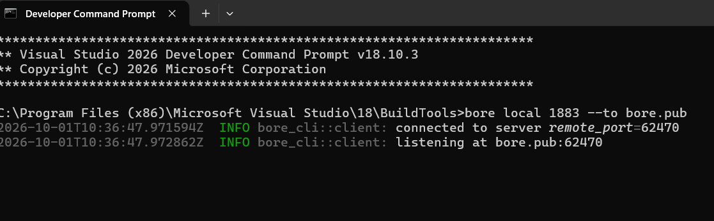
*Figure 8 — bore tunnel running, listening at bore.pub:<PORT>*

- Ran `bore local 1883 --to bore.pub` with the Dockerized Mosquitto broker
  already running; bore assigned a public endpoint at bore.pub:<PORT>

**What was tested:**
- Confirmed raw MQTT pub/sub across the tunnel (external mosquitto_pub ->
  bore.pub -> local Dockerized broker -> local mosquitto_sub)

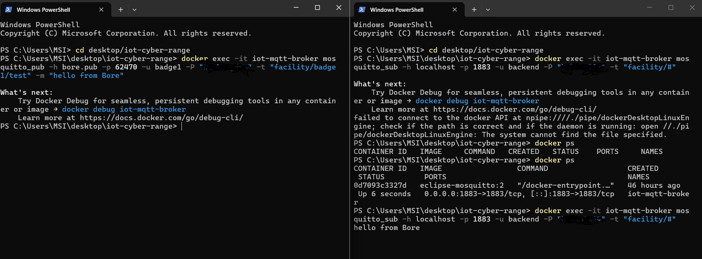
*Figure 9 — successful MQTT communication through the bore tunnel*

- Confirmed existing MQTT authentication works through the tunnel
  (authenticated client publish succeeded)

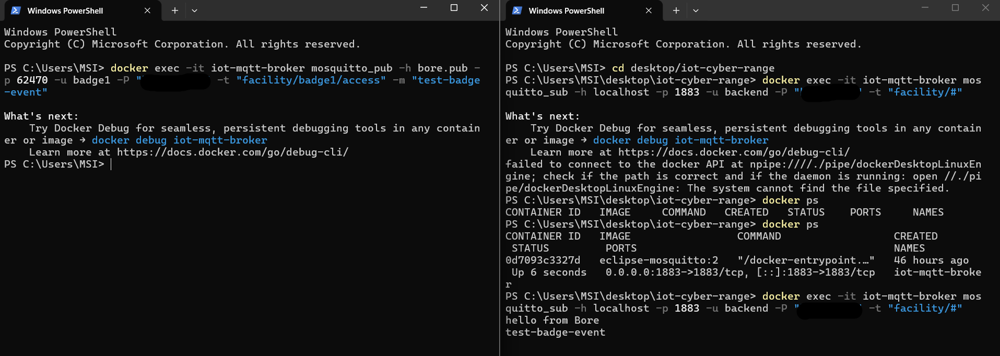
*Figure 10 — authenticated MQTT publish accepted through bore.pub*

- Confirmed ACL restrictions still apply through the tunnel: an
  unauthorized publish attempt to a restricted topic was correctly
  rejected, proving the security layer survives tunneling, not just local
  connections

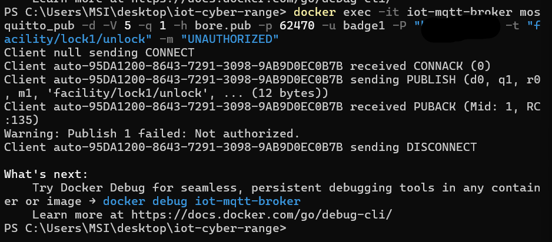
*Figure 11 — ACL correctly blocking an unauthorized publish through the tunnel*

**Important limitation:** bore's documentation states forwarded traffic is
NOT encrypted by default (the shared secret, if used, only protects the
initial handshake). This tunnel is being used strictly as a development/
university demo mechanism to let Wokwi's cloud-simulated ESP32 reach our
local broker, not as production-secure MQTT transport. This limitation is
documented here for the report's security assessment section.

**Known caveat:** bore.pub assigns a random port each restart (same as
ngrok/serveo free tiers) — must be updated in the Wokwi sketch each session.
Some intermittent connection instability was observed during testing
(connections timing out on occasion) — treated as a known limitation of the
free, community-run relay rather than a bug in our setup.

**Next:** harden broker authentication, then write the first ESP32
(badge-controller) sketch in Wokwi.

---

## Step 4 (cont.): Broker authentication hardening

**What was done:**
- Added `Broker/passwordfile` with per-device MQTT credentials (including `badge1`)
- Set `allow_anonymous false` in `mosquitto.conf`, replacing the earlier
  development-mode anonymous access
- Re-verified ACL enforcement under real authentication: an unauthorized
  publish attempt was correctly rejected

**Resolves:** the two previously open Known Issues items — `allow_anonymous
true` and "ACL not yet tested under real authentication" — are now closed
(see updated Known Issues section below).

**Next:** write the first ESP32 (badge-controller) sketch in Wokwi, using
the bore.pub:<PORT> address and the `badge1` credentials.

---

## Step 5: badge-controller ESP32 firmware (Wokwi)

**What was done:**
- Created the Wokwi ESP32 project for `badge-controller`
- Added a push button on GPIO4 to simulate badge scanning, and a red LED on GPIO2
- Added the PubSubClient library

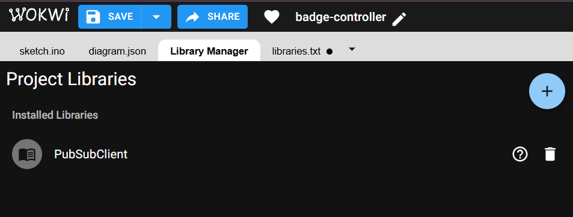
*Figure 13 — PubSubClient library added*

- Connected the ESP32 to Wokwi's simulated Wi-Fi (`Wokwi-GUEST`)
- Connected to the Mosquitto broker through the bore.pub tunnel, authenticated
  with the `badge1` MQTT account (scoped to publish-only on `facility/badge1/#`)

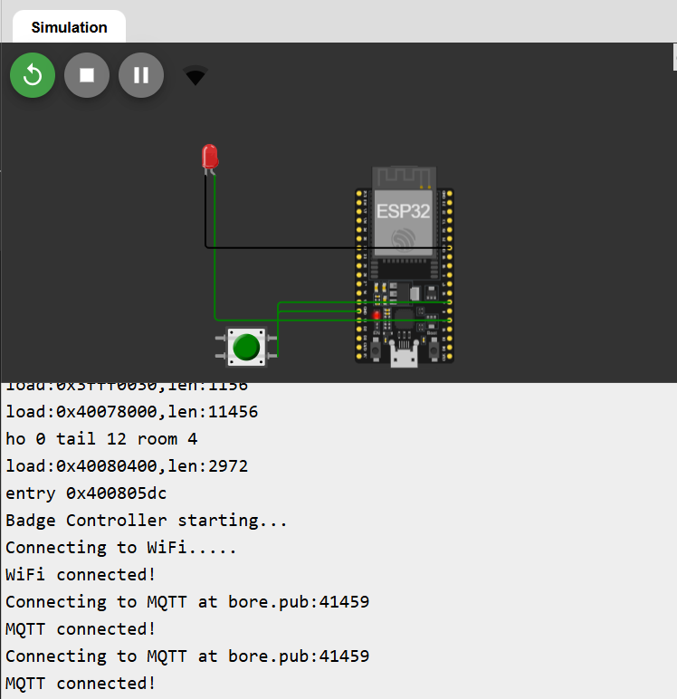
*Figure 14 — successful Wokwi MQTT connection*

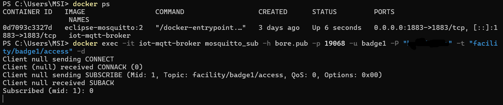
*Figure 15 — MQTT subscriber connection through bore*

- On button press, the ESP32 publishes `Badge detected` to `facility/badge1/access`

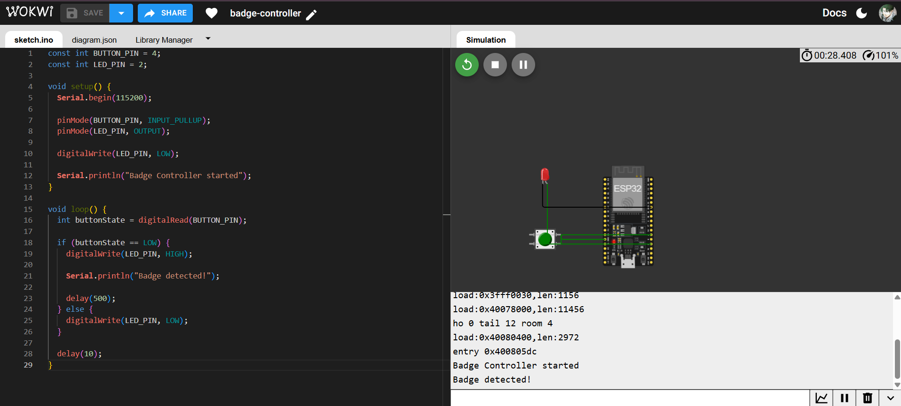
*Figure 12 — Wokwi badge-controller simulation (button/LED, serial output)*

**What was tested:**
- Verified the full path end-to-end:
  `Wokwi ESP32 → Wi-Fi → Bore → Mosquitto → MQTT subscriber`
- Confirmed `Badge detected` message received on `facility/badge1/access`
  by the MQTT subscriber

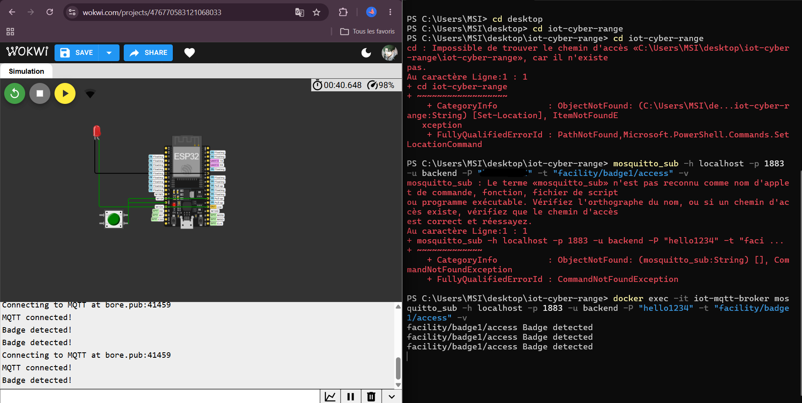
*Figure 16 — final end-to-end test: `Badge detected!` in Wokwi and
`facility/badge1/access Badge detected` in the MQTT subscriber*

**Security note:** the Wokwi `badge-controller` project may be shared
publicly, exposing the embedded `badge1` credential. This is treated as a
deliberate low-privilege design choice (least-privilege device identity,
scoped via ACL) rather than a secrecy failure — see README's "Known
technical constraint" section.

**Next:** build the attacker, honeypot, detection, dashboard and response
layer; `motion-sensor`, `lock-actuator` and the backend are planned
separately (Arij).

---

## Step 6: Development environment

**What was done:**
- Installed Docker Desktop with the **WSL 2** backend; verified with
  `docker run --rm hello-world`.
- Installed the VS Code extensions PlatformIO IDE, Wokwi Simulator and Docker.
- Requested a Wokwi licence (F1 → "Wokwi: Request a new License").

**Problems and answers:**
- *Is the VS Code Docker extension enough?* No. It is only a control panel for
  containers; it needs a real engine, which on Windows is Docker Desktop.
- *Simulated ESP32 reaching the broker:* Wokwi's built-in Wi-Fi gives internet
  access, so the bore tunnel (`bore local 1883 --to bore.pub`) still works.
  A Wokwi private gateway (`host.wokwi.internal`) would remove the need for bore,
  but Wokwi's own example indicates it needs a paid Wokwi Club plan (not verified
  for this account).
- *bore changes its public port on every restart:* the port in `secrets.h` must
  be updated and the firmware rebuilt each session.

---

## Step 7: Review of the starting state and broker hardening

**State found:**
Only the broker, authentication, ACLs, the tunnel and the badge button existed.
No backend, no database, no motion or lock device, no detection.

**Problems found and how they were handled:**

| # | Problem | Why it mattered | Fix |
|---|---------|-----------------|-----|
| 1 | `lock1` could write `facility/lock1/#` but not read its command topic, and nobody could publish commands | "Forged command" meant nothing without a legitimate sender; the lock could not receive commands | `lock1` reads `facility/lock1/cmd`; new `controller` user is the only one allowed to write it |
| 2 | Topic names differed: README said `zone2` / `lock3`, ACL said `motion1` / `lock1` | Firmware, ACL and rules would disagree | One scheme: `facility/<device>/...` with `badge1`, `motion1`, `lock1` |
| 3 | Denied publishes are dropped by Mosquitto, so a subscriber never sees them | Recon and forged commands would be invisible to the IDS | Broker log written to a shared volume; the IDS reads the log |
| 4 | Devices arrive through the bore tunnel, so their source IP is the tunnel host | IP-based detection and blocking is unreliable for devices | Identify by MQTT username / client ID; the attacker runs inside the Docker network |
| 5 | Open item in this log assumed the ACL is keyed on client ID | Mosquitto keys ACL rules on the **username** | Item closed; the Figure 7 test passed because of the `badge1` username |
| 6 | Badge payload was plain text (`Badge detected`) | Nothing for rules to inspect, no way to spot replay | JSON payload with `device`, `badge_id`, `seq` (Step 11) |

**What was done:**
- `Broker/acl.conf`: per-device rules, a `controller` command sender, monitoring
  users (`backend`, `ids`, `dashboard`) and a `canary` account with no rights.
- `Broker/mosquitto.conf`: `allow_anonymous false`, password and ACL files,
  logging to stdout and to `/mosquitto/log/mosquitto.log` (`log_type all`,
  because denied publishes are logged at debug level, as far as we know).
- `docker-compose.yml`: broker published on `127.0.0.1:1883` only (bore connects
  to localhost, the LAN cannot reach the broker); log kept in a named volume
  shared with the IDS.
- `Broker/add-user.ps1` / `add-user.sh`: create or update users with
  `mosquitto_passwd` run through Docker, printing the password.
- `Broker/passwordfile.example` updated with the new users.

**Known limits:**
- `log_type all` makes the log grow fast; reset the log volume between runs.
- Read-denied subscriptions are not visible in the log (Mosquitto checks reads at
  delivery time), so "unauthorized subscribe" cannot be detected from denials.

---

## Step 8: Smoke tests of the broker

**What was done:**
Tested with `mosquitto_pub` / `mosquitto_sub` through `docker exec`:
1. allowed publish by `badge1` on its own topic → received by a `backend` listener,
2. allowed command by `controller` on `facility/lock1/cmd`,
3. `badge1` publishing to `facility/lock1/cmd` → denied (nothing delivered),
4. wrong password and anonymous connection → refused,
5. checked the broker log for traces of 3 and 4.

**Why:** the IDS depends on those log traces (Problem 3 in Step 7).

---

## Step 9: Security lab — attacker, honeypot, detection, dashboard, response

**What was done:**
 The lab includes the following components and attack scenarios:
- `docker-compose.yml` runs `mqtt-broker`, `honeypot`, `security-monitor`,
  `dashboard-proxy` (nginx) and an on-demand `attacker` container (`tools`
  profile). The lab network is Docker-internal; the broker and dashboard are
  published on `127.0.0.1` only.
- `Attacker/`: container running the scenarios `recon`, `command-injection`,
  `sensor-spoof` and `lateral-movement` against the lab only.
- `Lab/honeypot.py`: fake TCP maintenance console on internal port 2323; logs
  every contact to `Lab/runtime/events.jsonl`; never executes input.
- `Lab/monitor.py`: IDS and dashboard backend. Reads MQTT `facility/#`, the broker
  log and the honeypot log; stores events and alerts in SQLite; serves
  `/api/events`, `/api/alerts`, `/api/respond`.
- `Lab/dashboard.html` behind an nginx proxy: live event feed, alerts list,
  block button.
- `Lab/response.ps1`: host script (`Watch` / `Block` / `Unblock`) that applies
  queued blocks by adding a deny block for the user to the ACL and restarting
  the broker.
- `Lab/run-scenario.ps1`: runs a scenario in the attacker container.
- Unit tests for the monitor and honeypot; the IDS password is passed as a Docker
  secret; the attacker sits on an internal Docker network.

**Design notes:**
- Devices reach the broker through the bore tunnel, so detection identifies
  clients by MQTT username (resolved through the client ID), not by IP.
- Restarting the broker to apply a block disconnects every client.

---

## Step 10: Code review of the lab

**What was done:**
Reviewed the full repo (secrets files were not opened), ran the unit tests (7
passed at that point) and probed the parsing with realistic input.

| # | Finding | Impact |
|---|---------|--------|
| 1 | Mosquitto's denial lines name the **client ID**, not the username; the monitor expected a username and took the source from "the last connection seen". The unit test used an invented log line | Alerts had no username; source could be mislabelled when other clients connect |
| 2 | Honeypot regex matched `id` / `cat` anywhere (`?id=5`, `/cat/status`); plain honeypot contact raised no alert | False positives and a missed signal |
| 3 | Log-watcher thread only caught a few exception types and could die silently | Detection could stop while the dashboard looked healthy |
| 4 | Replay rule: a spoofed `seq` of 999999 made every later real reading a "replay"; a device reboot also caused false alerts | Rule could be poisoned and noisy |
| 5 | `/api/respond` had no authentication and ignored Content-Type; any web page or the attacker container could queue a block, including on `ids` | Detection could be blinded |
| 6 | Block is a second `user X` ACL section; only "applied and removed" was tested, not that publishes are denied | Response action unproven |
| 7 | Wokwi/PlatformIO files at repo root, sketch in `esp32/badge-controller/`, no `diagram.json` next to `wokwi.toml`, no `lib_deps` | Simulation could not be built |
| 8 | Badge sketch hard-coded the MQTT password and bore port | Secret in source |
| 9 | This log still listed `zone2` / `lock3` | Stale documentation |

---

## Step 11: Patch applied

**What was done:**
- **Badge project (#7, #8):** `esp32/badge-controller/` is its own PlatformIO +
  Wokwi project (`platformio.ini`, `wokwi.toml`, `src/main.cpp`,
  `include/secrets.example.h`), opened as its own folder in VS Code.
  Credentials and bore port live in a git-ignored `secrets.h`. Payload is JSON:
  `{"device":"badge1","badge_id":"B-102","seq":N}`, with a 500 ms button
  debounce. Non-blocking MQTT reconnect and Wi-Fi reconnect added. Old root
  PlatformIO files and `sketch.ino` removed.
- **Denial attribution (#1):** the monitor keeps a `client id → (ip, username)` map
  from "New client connected" lines and resolves denials through it. Source
  falls back to the last connection only for anonymous rejections.
- **New rule `forged-lock-command` (high):** denied publish to `facility/<device>/cmd`.
- **Honeypot (#2):** command-injection regex now needs a separator or operator
  (`;whoami`, `|cat`, `&&`, `$(`, backtick); `?id=5` and `/cat/status` are no
  longer flagged. New low-severity `honeypot-contact` alert for any contact.
- **Watcher (#3):** catches every exception per line and per pass, and waits for
  half-written lines.
- **Replay rule (#4):** keeps a window of recent sequence numbers; a restart is
  not a replay; a jump of more than 1000 raises `sensor-seq-jump` without
  poisoning later readings.
- **API (#5):** `/api/respond` needs `Authorization: Bearer <DASHBOARD_TOKEN>`
  (set in `.env`) and a JSON Content-Type; it fails closed when no token is set.
  `ids` and `dashboard` can no longer be blocked from the dashboard or
  `response.ps1`. The dashboard has a token box.
- **Tests:** 22 unit tests (19 for the monitor, 3 for the honeypot), including
  realistic Mosquitto log lines, client attribution when other clients connect
  in between, partial-line reading and the API's 503 / 401 / 415 / 202 / 400
  responses. The badge firmware was syntax-checked against stub headers (not a
  real PlatformIO build).
- **Repository:** the lab was merged into the main repository through a pull
  request.

**Detection rules now in `Lab/monitor.py`:** `honeypot-contact`,
`command-injection-attempt`, `unauthorized-mqtt-activity`, `forged-lock-command`,
`honeypot-to-broker-correlation`, `sensor-range-anomaly`, `sensor-replay`,
`sensor-seq-jump`, `response-requested`.

**Status of the firmware:** a PlatformIO build and a Wokwi run of this version
have not been recorded yet (Figures 12–16 come from the earlier Wokwi-web
version, which sent plain text).

---

## Step 12: Running the lab locally

**What was done:**
1. Created the broker accounts with `Broker/add-user.ps1` (passwords kept in the
   git-ignored `Broker/passwords.txt`).
2. Created `Broker/ids.password` (the IDS account only) and `.env` with the
   dashboard token.
3. Started everything with `docker compose up -d --build`.

**Problems met and how they were handled:**

| Problem | Cause | Fix |
|---------|-------|-----|
| `no configuration file provided: not found` | Command run from the wrong folder | Run Docker commands from the repository root (where `docker-compose.yml` is) |
| `failed to connect to the docker API` while creating users | Docker Desktop was not running | Start Docker Desktop and wait for the engine; check with `docker version` |
| Container name `/iot-mqtt-broker` already in use | Container left over from the earlier setup in another folder | `docker rm -f iot-mqtt-broker`, then `docker compose up -d` |
| Dashboard proxy failed: port 8080 not available | Another local service (an Oracle Database listener) already uses 8080 | The dashboard host port is configurable: `DASHBOARD_PORT` in `.env` (default 8080) |
| `response.ps1` "is not digitally signed" | File came from a downloaded zip and Windows marked it as from the internet | `Unblock-File .\Lab\response.ps1`, or `Get-ChildItem -Recurse -Include *.ps1 \| Unblock-File`; alternative: `Set-ExecutionPolicy -Scope Process -ExecutionPolicy Bypass` |
| Old generic alerts ("rejected a connection or topic operation") still listed after the patch | Rows from earlier runs remain in the SQLite DB | Reset: `docker compose down -v`, empty `Lab\runtime\`, `docker compose up -d` (wipes all history) |
| Question about enabling a VS Code env setting | Not needed: Docker Compose reads `.env` from the repo root by itself | None; `python.terminal.useEnvFile` only matters for VS Code terminals and nothing here uses it |
| Where to run each command | Mixed repo-root and firmware-folder steps | Rule: PowerShell at the repo root for Docker/scripts; VS Code opened on `esp32/badge-controller/` for firmware |

**Result:** the broker, honeypot, security monitor and dashboard proxy start
and the dashboard opens on the configured port.

---

## Step 13: Attack scenarios, verification and evidence

**Early manual tests** (a first, hand-run attacker container, before the
scripted scenarios):

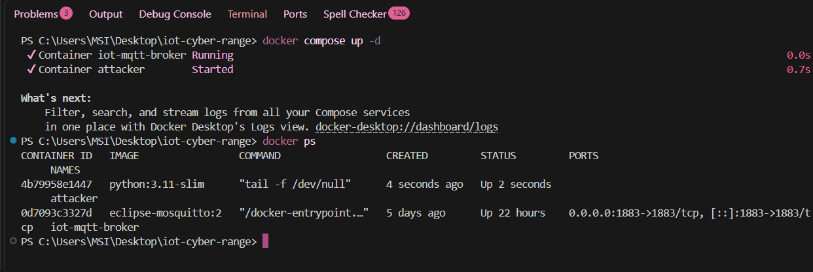
*Attacker container and broker running in Docker*

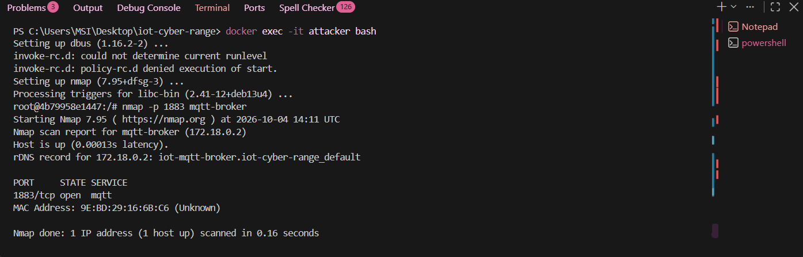
*Reconnaissance: nmap from the attacker container finds `1883/tcp open mqtt`
on the broker*

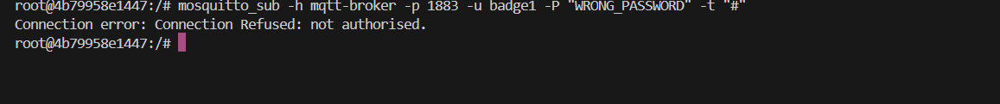
*Wrong password for `badge1`: `Connection Refused: not authorised`*

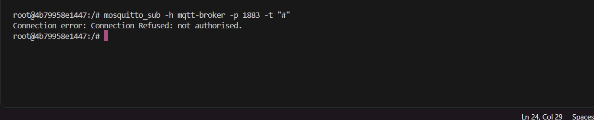
*Anonymous connection: `Connection Refused: not authorised`*

**Scripted scenarios** (run with
`Lab/run-scenario.ps1 -Scenario <recon|command-injection|sensor-spoof|lateral-movement>`):
- `recon`: probes the honeypot, then attempts an anonymous MQTT connection;
  the broker must reject it.
- `command-injection`: sends harmless command-like text to the honeypot; it is
  recorded and never executed.
- `sensor-spoof`: publishes an out-of-range motion reading with a device
  account.
- `lateral-movement`: probes the honeypot, then `badge1` tries to publish to
  `facility/lock1/cmd`; the ACL must deny it.

**Scenario run (`lateral-movement`) — result:**
```
honeypot-to-broker-correlation  critical
forged-lock-command             high      badge1 tried to publish to facility/lock1/cmd ...
unauthorized-mqtt-activity      medium    Mosquitto rejected a publish from badge1.
honeypot-contact                low       172.19.0.6 contacted the simulated maintenance honeypot ...
```
All four expected alerts appeared, the username (`badge1`) is resolved, and the
honeypot contact and the broker denial were correlated by the same source IP. This
confirmed the assumption about the Mosquitto log format. (Six older alerts with
the generic wording were leftovers from earlier runs.)

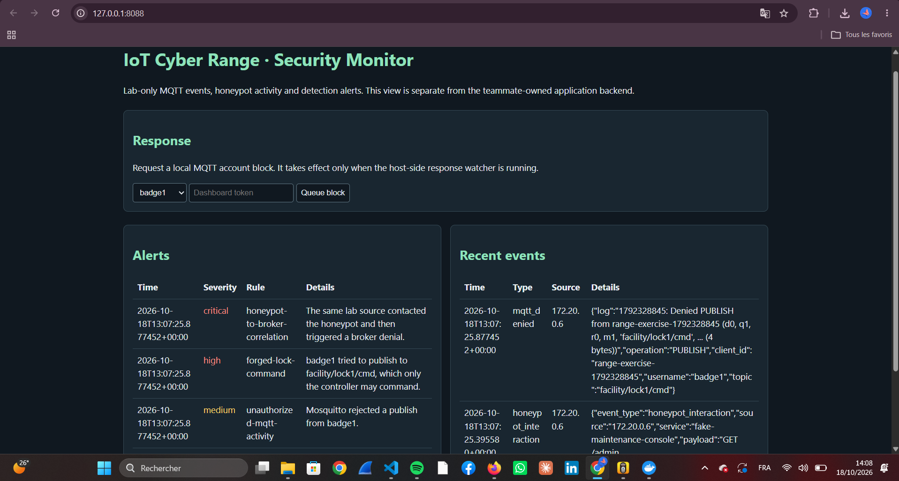
*Security-monitor dashboard showing the alerts raised by the scenarios*

**Note:** the early manual tests prove authentication rejection and port
discovery. A silent drop of a denied publish is not visible in the client
output; the denial is shown by the broker log and by the dashboard alert.

**Honeypot scope decision (badge controller only):**
- The honeypot stands for the **badge controller's maintenance console only**.
  There is no honeypot for the motion sensor or the lock.
- It does not depend on Arij's work. It is a plain TCP service that writes events
  to `Lab/runtime/events.jsonl`; it does not use MQTT, the backend or the motion
  and lock devices. The correlation with the broker uses only the attacker's
  source IP.
- In the code it is still labelled generically (`fake-maintenance-console`,
  "Maintenance console unavailable."). Relabelling it as a badge-controller
  console is optional and cosmetic.

---

## Step 14: Backend, remaining firmwares and review 

**What was found in the repo:**
- `Backend/` (FastAPI + PostgreSQL) now exists: `ingest.py` (pure parsing and
  validation), `service.py` (rules), `mqtt_service.py` (read-only `backend`
  client + `controller` command publisher), `db.py`, `schema.sql`, `main.py`
  (REST API), `tools/simulate_devices.py`, and pytest suites
  (`test_ingest.py`, `test_service_db.py`).
- `esp32/motion-sensor/` (HC-SR04, JSON readings, Last Will status) and
  `esp32/lock-actuator/` (fail-secure lock, siren, retained state) exist with
  their own `platformio.ini`, `wokwi.toml` and `diagram.json`.
- `docker-compose.yml` gained `postgres` (on an internal `backend-db` network)
  and `backend`.

**Backend design notes:**
- Every `facility/#` message is journaled in `mqtt_events` (valid or not), then
  projected into `badge_events`, `motion_readings`, `lock_states`.
- Device identity comes from the **topic** (guarded by the ACL); the `device`
  field inside the payload is untrusted. A mismatch marks the event `spoofed`.
- Rules act only on *trusted* events (valid, not retained, not spoofed):
  authorized badge -> `UNLOCK`; 3 denied scans in 60 s -> `ALARM`.
- Least privilege: `backend` reads `facility/#`; `controller` is the only
  account that writes `facility/lock1/cmd`.
- Write endpoints need `API_TOKEN` and fail closed when it is empty; a
  per-device rate limit (600/min) drops floods.

**Problems found in review:**

| # | Problem | Impact | Fix / decision |
|---|---------|--------|----------------|
| 1 | `dashboard-proxy` and `backend` both published `127.0.0.1:8081` | The second container would fail to start | Dashboard stays on 8081, backend API moved to **8082** |
| 2 | Backend turns a scan of an authorized badge into `UNLOCK`; the `badge1` credential is meant to be low-privilege and may be public (Wokwi), and `B-102` is in the firmware | Anyone with the credential can open the door; the README claimed it only allows "fake events" | README corrected; to demo as a `badge-replay` scenario and add a detection rule (replay / `seq` check on badges) |
| 3 | `GET /api/*` (including `/api/badges`) is unauthenticated and reachable from the attacker container | Authorized badge IDs can be listed | Decide: add a read token, or keep it and document it |
| 4 | IDS range is 1..1000 cm, backend range is 2..400 cm | Two systems disagree on what is anomalous | Align on the HC-SR04 range |
| 5 | Alerts are in SQLite (security monitor), events in PostgreSQL (backend) | Two stores, two dashboards | Store alerts in the backend DB or publish them on an `alerts/#` topic |
| 6 | README and Notes still described backend, motion sensor and lock as not started | Stale documentation | README rewritten; this step added |

**Status of the firmware and backend:** code written and unit-tested
(`test_ingest.py` always; `test_service_db.py` needs `TEST_DATABASE_URL`).
No PlatformIO build, Wokwi run or full end-to-end run (badge -> backend ->
`UNLOCK` -> lock state) has been recorded yet.

---

## Known issues / tech debt

- [ ] **Motion and lock firmware:** Run the PlatformIO builds and Wokwi simulations for both devices and record the results.
- [ ] **Backend integration:** Verify integration between the IDS, backend database, and device firmware.
- [ ] **Badge replay:** Implement and test replay detection and sequence validation.
- [ ] **Unauthenticated backend reads:** Review read endpoints and implement appropriate access control.
- [ ] **Sensor range mismatch:** Align IDS and backend validation ranges.
- [x] **Backend port conflict:** Resolved; backend API recorded on port 8082.


| Figure | Description |
|---|---|
| 1 | IoT Cyber Range project structure |
| 2 | Mosquitto MQTT broker configuration |
| 3 | MQTT access control rules |
| 4 | Mosquitto broker running inside a Docker container |
| 5 | Successful Mosquitto broker initialization |
| 6 | Successful MQTT communication between a device and the backend |
| 7 | ACL preventing badge1 from publishing to the lock actuator topic |
| 8 | Bore tunnel running |
| 9 | MQTT communication through the bore tunnel |
| 10 | Authenticated MQTT publish through bore.pub |
| 11 | ACL correctly blocking an unauthorized publish through the tunnel |
| 12 | Wokwi badge-controller simulation (button/LED, serial output) |
| 13 | PubSubClient library added |
| 14 | Successful Wokwi MQTT connection |
| 15 | MQTT subscriber connection through bore |
| 16 | Final end-to-end test: Badge detected! (Wokwi) → facility/badge1/access (subscriber) |
| Attacker_Docker_Container_Running | Attacker container and broker running in Docker |
| Attacker_Nmap_MQTT_Port_Discovery | nmap finds the MQTT port from the attacker container |
| Attacker_Invalid_MQTT_Credentials_Blocked | Wrong password rejected: not authorised |
| Attacker_Unauthorized_MQTT_Access_Blocked | Anonymous connection rejected: not authorised |
| Attacker_Dashboard_Alerts | Security-monitor dashboard with alerts from the scenarios |
---
## Initial Pre-Start Inspection — 2026-10-19

This subsection records the initial inspection before the project services were started. These results describe the state at that time, not the later runtime verification.

- `docker compose config --quiet` passed.
- Six default services were defined in the Compose configuration.
- `.env` was absent at the time of this inspection; `.env.example` existed and was tracked.
- `docker compose ps` showed no running services for this project.
- Some containers were in the `Created` state.
- The older `iot-merge` project owned container `iot-mqtt-broker` and host port `127.0.0.1:1883`.
- Ports 8081 and 8082 were not listening at the time of inspection.
- Seven baseline screenshot files were reported as untracked at the time.

The initial inspection did not confirm successful startup or end-to-end operation. The later baseline section records the subsequent checks.

## Baseline Verification — 2026-10-19

This section records the later runtime and security checks performed on the IoT Cyber Range Docker Compose environment. Results are limited to the specific checks described below; successful endpoint responses do not establish that every security feature works correctly.

### 1. Docker Compose configuration and startup

**Result: PASS**

- `docker compose config --quiet` returned exit code 0.
- The six default services were started: MQTT broker, PostgreSQL, backend, honeypot, security monitor, and dashboard proxy.
- PostgreSQL reported a healthy status.

### 2. Backend health and API endpoints

**Result: PASS for the tested checks**

- `GET /health` returned `status: ok`.
- Database connectivity, MQTT ingestion, and MQTT controller connectivity were reported as `True`.
- The rate-limit counter was zero.
- The following read endpoints responded successfully: `/api/devices`, `/api/events`, `/api/badge-events`, `/api/motion`, `/api/lock/state`, `/api/lock/commands`, `/api/badges`, and `/api/stats`.

### 3. Dashboard and security-monitor endpoints

**Result: PASS for endpoint availability**

- `http://127.0.0.1:8081/` returned HTTP 200 with a non-empty HTML response.
- `/api/events` returned HTTP 200.
- `/api/alerts` and `/api/responses` returned valid JSON arrays.

These checks establish endpoint availability and response format, not complete detection or response-action functionality.

### 4. API authentication

**Result: PASS for the tested unauthorized requests**

The following requests were rejected with HTTP 401:

- Unauthenticated `POST /api/respond`.
- `POST /api/lock/command` with an invalid token.
- `POST /api/badges` with an invalid token.
- Dashboard-proxied `POST /api/respond` with an invalid token.

### 5. MQTT authentication

**Result: PASS for the tested authentication cases**

- Invalid MQTT credentials were rejected with `Connection Refused: not authorised`.
- Valid backend credentials received a successful CONNACK and SUBACK when subscribing to an authorized topic.
- The subscriber timed out while waiting for a message because none was published during the test; this was expected.

### 6. MQTT access control and audit logging

**Result: PASS for the tested denials**

- The backend account's publish attempt to `facility/lock1/command` was denied.
- The controller's publish attempt to `facility/lock1/auth-test` was denied because the configured controller permission is limited to `facility/lock1/cmd`.
- The broker audit log contained `Denied PUBLISH` entries for the rejected operations.

**Limitation:** An authorized publish to `facility/lock1/cmd` was not performed because it can trigger simulated lock or alarm actions. The controller ACL rule was inspected, but the authorized command path has not been validated end to end.

### 7. Honeypot availability

**Result: PASS for startup only**

The honeypot log reported:

`Lab honeypot listening on internal TCP port 2323`

This confirms startup and listening status. It does not, by itself, establish that connection handling, event logging, or suspicious-activity detection all work correctly.

### 8. Attack-scenario testing status

The earlier Step 13 lateral-movement scenario **passed its recorded alert checks**. It produced four expected alerts:

- `honeypot-to-broker-correlation` — critical
- `forged-lock-command` — high
- `unauthorized-mqtt-activity` — medium
- `honeypot-contact` — low

The recorded run resolved the username to `badge1` and correlated the honeypot contact with the broker denial by source IP. Six older generic alerts were leftovers from previous runs.

The manual tests also recorded MQTT port discovery, rejection of invalid credentials, and rejection of anonymous access.

**Still pending:** Additional scripted scenario verification, explicit verification of the response action, and the complete device-to-backend-to-lock workflow. Endpoint availability must not be presented as proof that these tests passed.

### 9. Configuration and security observations

- **MQTT encryption:** The broker uses plain TCP without TLS. Credentials and MQTT messages are not encrypted in transit.
- **Broker file permissions:** Mosquitto logged ownership and permission warnings for `mosquitto.conf`, `acl.conf`, and `passwordfile` under Windows bind mounts.
- **PostgreSQL authentication:** Initialization logs included a warning about `trust` authentication for local connections. The effective authentication rules need review.
- **Authorized controller path:** The ACL rule exists, but a safe end-to-end command test remains outstanding.

These items require follow-up; they do not invalidate the individual checks that passed.

### 10. Baseline conclusion

The later checks verified service startup, backend health, dashboard and monitoring endpoint availability, rejection of tested unauthorized API and MQTT requests, MQTT ACL denials, broker audit logging, and honeypot startup.

The lateral-movement scenario and its four expected alerts were already recorded in Step 13. Additional attack scenarios, response-action verification, and the authorized controller command path remain pending. Full end-to-end operation has not yet been recorded as successful.
