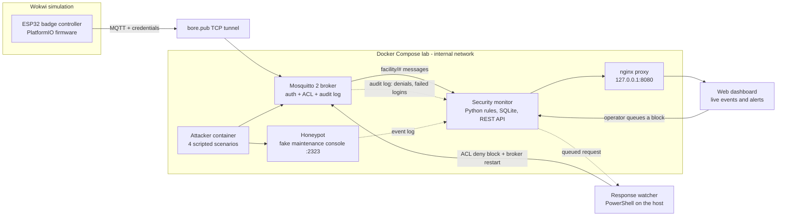
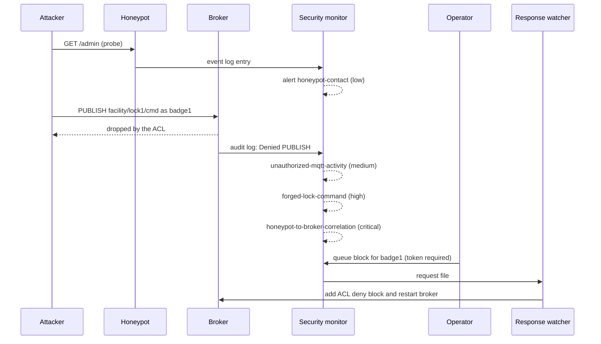

# IoT Cyber Range

A virtual IoT security lab: simulated ESP32 devices (Wokwi) representing a
facility access-control system, communicating over MQTT, with a controlled
attack → detection → alert → response pipeline built around Docker Compose.

> **Educational project.** Every attack runs only against the local, simulated
> lab. See [Ethical use](#ethical-use).

## Concept

Three IoT devices simulate a small facility access-control system:

- **ESP32 #1 — Badge/RFID controller** (`badge-controller`, completed):
  publishes access events to `facility/badge1/access`
- **ESP32 #2 — Motion sensor** (`motion-sensor`, planned): publishes readings
  under `facility/motion1/`
- **ESP32 #3 — Lock/siren actuator** (`lock-actuator`, planned): subscribes
  to commands on `facility/lock1/cmd` to lock/unlock or trigger an alarm

All devices communicate over MQTT through a Dockerized Mosquitto broker.

The security layer provides a controlled **attacker** environment, a
non-executing **honeypot**, a rule-based **detection** service, local event
storage and a live **dashboard**. An operator can request a broker-account
block; applying it updates the local ACL and restarts the broker.

Full pipeline: IoT devices → attack → monitoring → detection → logging →
alert → investigation → optional response.

## Architecture



The motion sensor and lock actuator are planned and will follow the same
pattern as the badge controller: publish to `facility/<device>/...` with their
own credentials. The lock receives commands on `facility/lock1/cmd`, which only
the `controller` account may write.

### Attack-to-response walkthrough

The `lateral-movement` scenario end to end:



## Components

- **esp32/** — one folder per device
  - `badge-controller/` — **completed**: PlatformIO + Wokwi project; push
    button (GPIO4) simulates a badge scan, red LED (GPIO2), PubSubClient
    library, publishes JSON (`device`, `badge_id`, `seq`) to
    `facility/badge1/access`; credentials are kept in the git-ignored
    `include/secrets.h`
  - `motion-sensor/`, `lock-actuator/` — **not started yet**
- **Broker/** — `mosquitto.conf`, `acl.conf`, user-management scripts
  (`add-user.ps1`, `add-user.sh`), `passwordfile.example`
- **Backend/** — MQTT subscriber + API (**not started yet**)
- **Lab/** — honeypot, IDS/detection engine, local dashboard, response script,
  unit tests
- **Attacker/** — on-demand, lab-only MQTT and honeypot exercises
- **screenshots/** — evidence figures referenced in `Notes.md`
- **docker-compose.yml** — orchestrates the broker, honeypot, security monitor,
  dashboard proxy and the optional attacker container; the application backend
  remains separate
- **.env.example** — template for the dashboard token

## Attack scenarios

Run with `Lab/run-scenario.ps1 -Scenario <name>`. All scenarios contact only
the internal Compose broker and honeypot.

| Scenario | What it does | Expected result |
|----------|--------------|-----------------|
| `recon` | Probes the honeypot, then tries an anonymous MQTT connection | Anonymous access rejected; honeypot contact logged |
| `command-injection` | Sends harmless command-like text (`...;whoami`) to the honeypot | Input recorded, never executed; high-severity alert |
| `sensor-spoof` | Publishes an out-of-range motion reading with a huge sequence number using a device account | Range-anomaly alert |
| `lateral-movement` | Probes the honeypot, then a low-privilege account tries to publish to the lock command topic | ACL denial, forged-command alert, critical correlation alert |

## Detection rules

| Rule | Trigger | Severity |
|------|---------|----------|
| `honeypot-contact` | Any connection to the honeypot | low |
| `command-injection-attempt` | Shell-style separators or operators followed by a command (`;whoami`, `\|cat`, `&&`, `$(`) | high |
| `unauthorized-mqtt-activity` | Broker denied a publish/subscribe or refused a login | medium |
| `forged-lock-command` | Denied publish to a `facility/<device>/cmd` topic | high |
| `honeypot-to-broker-correlation` | Same source hit the honeypot and then triggered a broker denial within 2 minutes | critical |
| `sensor-range-anomaly` | Motion distance outside the allowed range | high |
| `sensor-replay` | A sequence number already seen recently | medium |
| `sensor-seq-jump` | Sequence number jumps by a large amount | medium |
| `response-requested` | An operator queued an account block | info |

## Tech stack

- ESP32 simulation: Wokwi, PlatformIO
- ESP32 firmware library: PubSubClient (Arduino)
- MQTT broker: Eclipse Mosquitto 2 (Dockerized), username/password auth + ACLs
- Public tunnel: bore (open-source, bore.pub relay)
- Backend: planned, not implemented yet
- Event storage: local SQLite used by the IDS/dashboard service
- Detection: Python rule-based MQTT and log monitor using Paho MQTT
- Honeypot: bounded fake TCP maintenance console; input is recorded, never
  executed
- Dashboard: local HTML/JavaScript event and alert feed served through nginx
- Attacker tooling: Python/Paho scripts restricted to the Compose lab network
- Host automation: PowerShell (user management, scenario runner, response
  watcher)
- Testing: Python `unittest`

## Known technical constraint

Wokwi's simulated ESP32 network is not on the same LAN as our Docker
containers — it needs a real, reachable broker address. We expose the
Dockerized Mosquitto broker via [bore](https://github.com/ekzhang/bore), an
open-source TCP tunnel to the public `bore.pub` relay, so Wokwi firmware can
connect to it over the internet, entirely free and with no payment
information required (we moved off ngrok because its free tier now requires
a credit/debit card for TCP tunnels).

- `bore.pub` assigns a new random port on every restart — update the broker
  port in `include/secrets.h` each session.
- Forwarded traffic is **not encrypted** by default (per bore's own
  documentation). Acceptable for this development/demo context, not intended
  as production-secure transport.
- The free `bore.pub` relay has shown intermittent connection instability
  under testing — documented as a known limitation. The firmware reconnects
  automatically.

Each device's MQTT credentials (e.g. `badge1`) are scoped via ACLs to only
publish on that device's own topic. Since a Wokwi project may be shared or
public, device credentials are treated as low-privilege by design rather than
secret — leaking one only allows fake events for that device.

The security lab network is Docker-internal. The MQTT port and dashboard are
published only on `127.0.0.1`; the attacker and honeypot ports are not
published to the host or internet. The command-injection exercise sends
command-like text to a fake service that records it without invoking a shell.
This is a teaching lab, not a production IDS or containment system.

## Setup

All commands run from the repository root in Windows PowerShell. Prerequisites:
Docker Desktop, and for the firmware VS Code with the PlatformIO and Wokwi
extensions plus bore.

1. Create the broker accounts and keep their passwords in the git-ignored
   `Broker/passwords.txt` (format `user:password`):

   ```powershell
   foreach ($u in "badge1","motion1","lock1","controller","backend","ids") {
       $pw = [guid]::NewGuid().ToString('N')
       .\Broker\add-user.ps1 $u $pw | Out-Null
       "$u`:$pw" | Add-Content Broker\passwords.txt
   }
   ```

2. Give the detection engine its least-privilege secret (the `ids` account):

   ```powershell
   ((Get-Content Broker\passwords.txt | Where-Object { $_ -like 'ids:*' }) -split ':', 2)[1] |
       Set-Content Broker\ids.password -NoNewline
   ```

3. Create the dashboard token (the block button stays disabled without it):

   ```powershell
   "DASHBOARD_TOKEN=$([guid]::NewGuid().ToString('N'))$([guid]::NewGuid().ToString('N'))" |
       Set-Content .env -Encoding ascii
   ```

4. Start the lab and open the dashboard at <http://127.0.0.1:8080>:

   ```powershell
   docker compose up -d --build
   docker compose ps
   ```

5. Run a bounded exercise:

   ```powershell
   powershell -NoProfile -ExecutionPolicy Bypass -File .\Lab\run-scenario.ps1 -Scenario recon
   powershell -NoProfile -ExecutionPolicy Bypass -File .\Lab\run-scenario.ps1 -Scenario command-injection
   powershell -NoProfile -ExecutionPolicy Bypass -File .\Lab\run-scenario.ps1 -Scenario sensor-spoof
   powershell -NoProfile -ExecutionPolicy Bypass -File .\Lab\run-scenario.ps1 -Scenario lateral-movement
   ```

6. To apply a dashboard block request, keep the host-side watcher running in a
   second PowerShell window, then paste the token from `.env` into the
   dashboard and queue a block. The watcher edits the lab ACL and restarts
   Mosquitto, which disconnects all lab clients:

   ```powershell
   powershell -NoProfile -ExecutionPolicy Bypass -File .\Lab\response.ps1 -Action Watch
   # restore an account afterwards:
   powershell -NoProfile -ExecutionPolicy Bypass -File .\Lab\response.ps1 -Action Unblock -User badge1
   ```

7. Run the badge-controller firmware in Wokwi:

   ```powershell
   bore local 1883 --to bore.pub            # note the public port it prints
   cd esp32\badge-controller
   Copy-Item include\secrets.example.h include\secrets.h
   code .
   ```

   Set `MQTT_PORT` and `MQTT_PASS` in `include/secrets.h`, build with
   PlatformIO, then run **Wokwi: Start Simulator**. Open the
   `esp32/badge-controller` folder itself in VS Code, not the repo root.

Run the unit tests with:

```powershell
docker compose run --rm --no-deps security-monitor python -m unittest -v
```

## Status

- [x] Repo structure created
- [x] `mosquitto.conf` written (listener 1883, ACL + password file referenced)
- [x] `acl.conf` written (per-device topic restrictions)
- [x] Mosquitto added to `docker-compose.yml` + tested locally (pub/sub confirmed)
- [x] Real MQTT authentication added (`passwordfile`, `allow_anonymous false`)
- [x] Public tunnel set up (bore.pub) and externally tested with auth/ACLs
- [x] First ESP32 (badge-controller) built and publishing to broker through bore
- [ ] Remaining 2 ESP32 firmwares (motion-sensor, lock-actuator)
- [ ] Backend event ingestion (Arij)
- [x] Attacker container with four bounded scenarios
- [x] Detection rules (unauthorized MQTT, command-like honeypot input, sensor anomalies)
- [x] Honeypot integrated into local event logging
- [x] Sensor-spoofing and honeypot-to-broker lateral-movement scenarios
- [x] Basic local dashboard (live event feed + alerts)
- [x] Response action (operator-approved local account block)
- [x] Controlled lab integration tests (attacks, detections, dashboard)
- [ ] Block action verified end to end (blocked account is actually denied)
- [ ] Full end-to-end test with the remaining devices and the backend
- [ ] Demo rehearsal
- [ ] Report written

See `Notes.md` for the detailed build log.

## Known issues / limitations

- Detection of denied operations depends on Mosquitto's log wording and log
  level, which may differ between versions.
- Denied *subscriptions* are not logged by Mosquitto (read ACLs apply at
  message delivery), so unauthorised eavesdropping cannot be detected this way.
- Applying a block restarts the broker and disconnects every client.
- Detection is rule-based; there is no anomaly or machine-learning component.
- Tunnel traffic is unencrypted (see Known technical constraint).

## Team / Work Distribution

**Ghada — Infrastructure & Cybersecurity Lead**

Completed:
- Overall architecture and repository structure
- Mosquitto broker configuration, per-device ACLs and real MQTT authentication
- Public bore TCP tunnel, tested with authentication and ACLs
- `badge-controller` ESP32 firmware, verified end to end through bore
- Security lab: attacker scenarios, honeypot, detection rules, dashboard and
  operator-approved response action

Remaining:
- Attack/defense testing against all three device firmwares and the backend
- Final security integration and demo rehearsal

**Arij — IoT Device & Data Lead**

- Implement the remaining two ESP32 firmwares (`motion-sensor`,
  `lock-actuator`) and their MQTT integration
- Device-side testing and integration
- Backend MQTT event ingestion, database schema, and event storage/processing
- Integration of all three ESP32 devices with the backend

## Timeline (6 weeks)

- Week 1: repo + broker + first ESP32 connectivity — **done**
- Week 2: all 3 ESP32 firmwares + backend ingesting events — **in progress
  (badge-controller done)**
- Week 3: attacker container + recon attack + first detection rule + basic dashboard
- Week 4: command-injection attack + honeypot
- Week 5: sensor-spoofing scenario + anomaly rule + lateral-movement correlation
- Week 6: response action, polish, demo rehearsal, buffer

## Ethical use

This lab exists for learning and defence. The attack scripts are deliberately
bounded: they target only the local Compose network and use harmless payloads.
Do not point them at systems you do not own or have explicit permission to
test.