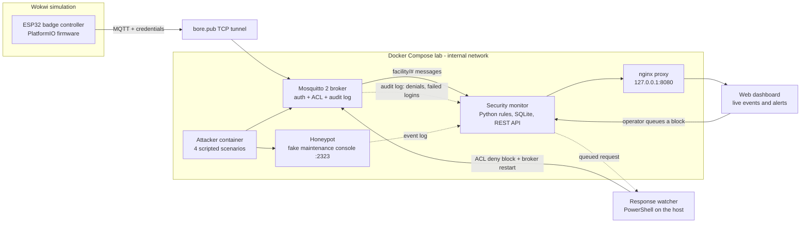
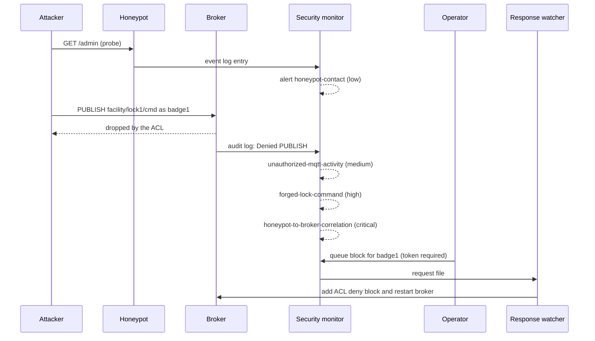

# IoT Cyber Range — Attack, Detection & Response Lab for MQTT-based IoT


A virtual IoT security lab. Simulated ESP32 devices represent a small facility
access-control system and talk MQTT through a hardened Mosquitto broker. Around
it sits a complete **attack → detection → alert → response** pipeline: scripted
attacks, a honeypot, a rule-based detection engine, a live dashboard and an
operator-approved response action — all running locally with Docker Compose.

> **Educational project.** Every attack runs only against the local, simulated
> lab. See [Ethical use](#ethical-use).

---

## Table of contents

1. [Architecture](#architecture)
2. [Attack-to-response walkthrough](#attack-to-response-walkthrough)
3. [My contribution](#my-contribution)
4. [Attack scenarios](#attack-scenarios)
5. [Detection rules](#detection-rules)
6. [Tech stack](#tech-stack)
7. [Repository structure](#repository-structure)
8. [Getting started](#getting-started)
9. [Security design decisions](#security-design-decisions)
10. [Testing](#testing)
11. [Screenshots](#screenshots)
12. [Limitations and future work](#limitations-and-future-work)
13. [Ethical use](#ethical-use)
14. [License](#license)

---

## Architecture



The other simulated devices (motion sensor, lock actuator) follow the same
pattern as the badge controller: publish to `facility/<device>/...` with their
own credentials. The lock receives commands on `facility/lock1/cmd`, which only
the `controller` account may write.

## Attack-to-response walkthrough

The `lateral-movement` scenario end to end:



## My contribution

This is a team project. The platform foundation — repository layout, the first
broker setup, the tunnel and the first simulated ESP32 — was put in place by the
team earlier; the remaining devices and the application backend (event
ingestion into a database) are developed separately and are not part of this
version. **My contribution is the security layer built on top of that platform:**

- **Security review and redesign of the broker access model.** Found and fixed an
  ACL that left the lock unable to receive commands and gave nobody the right to
  send them; introduced a dedicated `controller` account as the only command
  issuer, a deny-by-default `facility/<device>/...` topic scheme and read-only
  monitoring accounts (`backend`, `ids`).
- **Making rejected activity visible.** Mosquitto silently drops denied
  publishes, so no subscriber ever sees them. I added a broker audit log (shared
  volume) that the detection engine reads, and bound the broker to `127.0.0.1`.
- **Attack simulation.** An isolated attacker container with four bounded
  scenarios: reconnaissance, command injection, sensor spoofing and lateral
  movement.
- **Honeypot.** A decoy maintenance console, standing in for the badge
  controller's service interface, that records every contact and never executes
  input.
- **Detection engine (Python).** Rule-based monitoring of MQTT traffic, the
  broker log and the honeypot log; client-ID based attribution of denied
  operations to a username and source; cross-source correlation; replay and
  sequence-jump logic that survives device restarts.
- **Dashboard, API and response workflow.** Live event feed and alert list, a
  token-protected response API and an operator-approved account block applied by
  a host-side watcher.
- **Badge-controller firmware project.** Restructured into a standalone
  PlatformIO + Wokwi project with JSON payloads (`device`, `badge_id`, `seq`),
  secrets kept out of source and non-blocking Wi-Fi/MQTT reconnect.
- **Testing and review.** 22 unit tests (including realistic Mosquitto log lines
  and the API's authentication paths), live scenario verification and a
  security review of the lab tooling itself (for example closing an
  unauthenticated response endpoint).

## Attack scenarios

Run with `Lab/run-scenario.ps1 -Scenario <name>`. All scenarios contact only the
internal Compose broker and honeypot.

| Scenario | What it does | Expected result |
|----------|--------------|-----------------|
| `recon` | Probes the honeypot, then tries an anonymous MQTT connection | Anonymous access rejected; honeypot contact logged |
| `command-injection` | Sends harmless command-like text (`...;whoami`) to the honeypot | Input recorded, never executed; high-severity alert |
| `sensor-spoof` | Publishes an out-of-range motion reading with a huge sequence number using a device account | Range-anomaly alert |
| `lateral-movement` | Probes the honeypot, then a low-privilege account tries to publish to the lock command topic | ACL denial, forged-command alert, critical correlation alert |

## Detection rules

| Rule | Trigger | Severity |
|------|---------|----------|
| `honeypot-contact` | Any connection to the honeypot | low |
| `command-injection-attempt` | Shell-style separators or operators followed by a command (`;whoami`, `\|cat`, `&&`, `$(`) | high |
| `unauthorized-mqtt-activity` | Broker denied a publish/subscribe or refused a login | medium |
| `forged-lock-command` | Denied publish to a `facility/<device>/cmd` topic | high |
| `honeypot-to-broker-correlation` | Same source hit the honeypot and then triggered a broker denial within 2 minutes | critical |
| `sensor-range-anomaly` | Motion distance outside 1–1000 cm | high |
| `sensor-replay` | A sequence number already seen recently | medium |
| `sensor-seq-jump` | Sequence number jumps by more than 1000 | medium |
| `response-requested` | An operator queued an account block | info |

## Tech stack

| Area | Technology |
|------|------------|
| Device simulation | ESP32 (Arduino framework), Wokwi, PlatformIO, PubSubClient |
| Messaging | MQTT 3.1.1, Eclipse Mosquitto 2 (password file + ACL file) |
| Connectivity | bore TCP tunnel (bore.pub) to reach the broker from Wokwi |
| Detection and API | Python 3.12, Paho MQTT 2.1, SQLite, `http.server` |
| Dashboard | HTML / JavaScript served through nginx |
| Orchestration | Docker Compose (internal network, named volumes, Docker secret) |
| Host automation | PowerShell (user management, scenario runner, response watcher) |
| Testing | Python `unittest` |

## Repository structure

```text
.
├── Attacker/               # attacker container and its four scenarios
├── Backend/                # reserved for the ingestion service (not in this version)
├── Broker/                 # mosquitto.conf, acl.conf, user-management scripts
├── Lab/                    # honeypot, detection engine, dashboard, response watcher, tests
├── esp32/
│   └── badge-controller/   # PlatformIO + Wokwi project (firmware, circuit)
├── screenshots/            # evidence and README images
├── docker-compose.yml
├── .env.example            # DASHBOARD_TOKEN template
├── LICENSE
└── README.md
```

## Getting started

**Prerequisites:** Docker Desktop, Windows PowerShell, and for the firmware
VS Code with the PlatformIO and Wokwi extensions plus
[bore](https://github.com/ekzhang/bore).

All commands run from the repository root.

**1. Create the broker accounts** and keep their passwords in the git-ignored
`Broker/passwords.txt` (format `user:password`):

```powershell
foreach ($u in "badge1","motion1","lock1","controller","backend","ids") {
    $pw = [guid]::NewGuid().ToString('N')
    .\Broker\add-user.ps1 $u $pw | Out-Null
    "$u`:$pw" | Add-Content Broker\passwords.txt
}
```

**2. Give the detection engine its secret** (least-privilege `ids` account):

```powershell
((Get-Content Broker\passwords.txt | Where-Object { $_ -like 'ids:*' }) -split ':', 2)[1] |
    Set-Content Broker\ids.password -NoNewline
```

**3. Create the dashboard token** (the block button stays disabled without it):

```powershell
"DASHBOARD_TOKEN=$([guid]::NewGuid().ToString('N'))$([guid]::NewGuid().ToString('N'))" |
    Set-Content .env -Encoding ascii
```

**4. Start the lab** and open the dashboard at <http://127.0.0.1:8080>:

```powershell
docker compose up -d --build
docker compose ps
```

**5. Run an attack scenario:**

```powershell
powershell -NoProfile -ExecutionPolicy Bypass -File .\Lab\run-scenario.ps1 -Scenario lateral-movement
```

**6. Apply operator block requests** — keep this running in a second window,
then paste the token from `.env` into the dashboard and queue a block:

```powershell
powershell -NoProfile -ExecutionPolicy Bypass -File .\Lab\response.ps1 -Action Watch
# restore an account afterwards:
powershell -NoProfile -ExecutionPolicy Bypass -File .\Lab\response.ps1 -Action Unblock -User badge1
```

A block edits the lab ACL and restarts the broker, which disconnects all lab
clients.

**7. Run the badge-controller firmware in Wokwi:**

```powershell
bore local 1883 --to bore.pub            # note the public port it prints
cd esp32\badge-controller
Copy-Item include\secrets.example.h include\secrets.h
code .
```

Set `MQTT_PORT` and `MQTT_PASS` in `include/secrets.h`, build with PlatformIO,
then run **Wokwi: Start Simulator**. bore assigns a new port on every restart.

## Security design decisions

- **Least privilege, deny by default.** Each device may only publish to its own
  topic; the lock may only read its command topic; only `controller` may write
  commands; monitoring accounts are read-only.
- **Rejected requests are evidence.** The audit log turns denied publishes and
  failed logins into detection signals.
- **Identify by account, not by IP.** Devices reach the broker through a tunnel,
  so the source IP is unreliable; detection resolves each denial to the MQTT
  username through the client ID.
- **Containment.** The lab network is Docker-internal; the broker and dashboard
  are published on `127.0.0.1` only; the honeypot and attacker ports are not
  published.
- **The honeypot never executes input.** It records it, nothing more.
- **Protected response path.** The response API needs a bearer token and a JSON
  content type, fails closed when no token is configured, and cannot block the
  detection account.
- **No secrets in source.** Broker passwords, the IDS secret, the dashboard token
  and the firmware's `secrets.h` are git-ignored.

## Testing

22 unit tests cover the detection rules, broker-log parsing with realistic
Mosquitto lines, client attribution when other clients connect in between,
half-written log lines, the honeypot's injection filter and the dashboard API's
authentication.

```powershell
docker compose run --rm --no-deps security-monitor python -m unittest -v
```

The scenarios above were also run against the live stack and the resulting
alerts checked on the dashboard.

## Screenshots

| | |
|---|---|
|  |  |
| *Dashboard after a lateral-movement run* | *Attack scenario output and alerts* |


*Badge controller publishing JSON events from the Wokwi simulation*

## Limitations and future work

- This version contains one simulated device; the motion sensor, the lock
  actuator and the ingestion backend are not included.
- Detection of denied operations depends on Mosquitto's log wording and log
  level, which may differ between versions.
- Denied *subscriptions* are not logged by Mosquitto, so unauthorised
  eavesdropping cannot be detected this way.
- Applying a block restarts the broker and disconnects every client; a reload
  without restart, or Mosquitto's dynamic-security plugin, would be gentler.
- The bore tunnel is unencrypted and its free relay can be unstable; it exists
  only so that Wokwi can reach a local broker.
- Detection is rule-based; no anomaly or machine-learning component.
- Possible next steps: persist alerts in a shared database, a dedicated network
  for the attacker, TLS on the broker, more scenarios.

## Ethical use

This lab exists for learning and defence. The attack scripts are deliberately
bounded: they target only the local Compose network and use harmless payloads.
Do not point them at systems you do not own or have explicit permission to test.
The software is provided as is, without warranty (see the license).

## License

Released under the [MIT License](LICENSE).

---

*Development notes: parts of the implementation were produced with AI coding
assistants (GitHub Copilot, Claude). The design decisions, code review, integration
and testing were done by me.*
