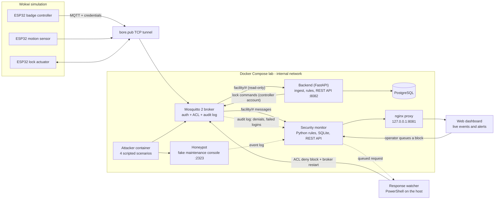
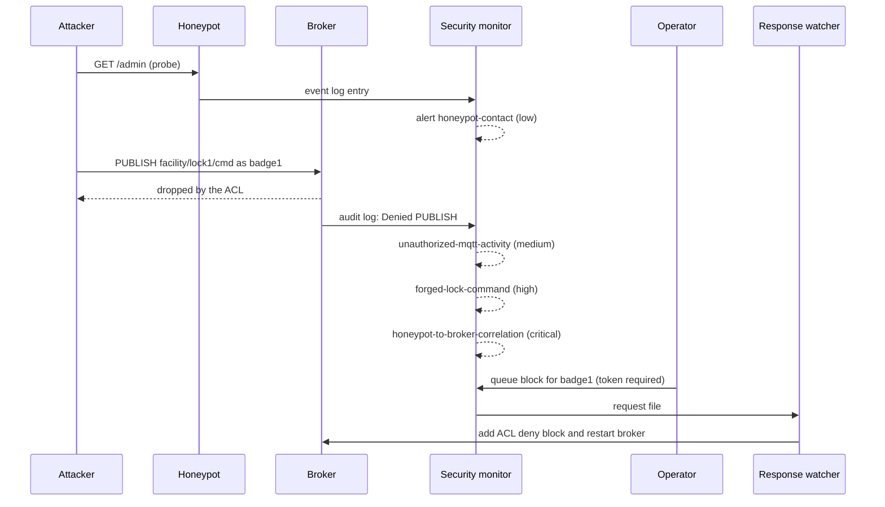

# IoT Cyber Range

A virtual IoT security lab: simulated ESP32 devices (Wokwi) representing a
facility access-control system, communicating over MQTT, with an application
backend (PostgreSQL + REST API) and a controlled
attack → detection → alert → response pipeline built around Docker Compose.

> **Educational project.** Every attack runs only against the local, simulated
> lab. See [Ethical use](#ethical-use).

## Concept

Three IoT devices simulate a small facility access-control system:

- **ESP32 #1 — Badge/RFID controller** (`badge-controller`): publishes access
  events to `facility/badge1/access`
- **ESP32 #2 — Motion sensor** (`motion-sensor`): HC-SR04 ultrasonic sensor
  publishing readings to `facility/motion1/reading` and presence to
  `facility/motion1/status`
- **ESP32 #3 — Lock/siren actuator** (`lock-actuator`): subscribes to commands
  on `facility/lock1/cmd`, publishes its state to `facility/lock1/state`;
  fail-secure (boots locked, auto re-lock, alarm timeout)

All devices communicate over MQTT through a Dockerized Mosquitto broker.

The **application backend** (`Backend/`, FastAPI + PostgreSQL) ingests every
`facility/#` message, validates and journals it, decides on badge scans
(authorized badge → `UNLOCK`, repeated denials → `ALARM`) and exposes a REST API.

The **security layer** provides a controlled attacker environment, a
non-executing honeypot, a rule-based detection service, local event storage and
a live dashboard. An operator can request a broker-account block; applying it
updates the local ACL and restarts the broker.

Full pipeline: IoT devices → backend → attack → monitoring → detection →
logging → alert → investigation → optional response.

## Architecture



Two broker accounts keep least privilege on the backend side: `backend` can only
**read** `facility/#`, and `controller` is the only account allowed to **write**
`facility/lock1/cmd`.

### Attack-to-response walkthrough

The `lateral-movement` scenario end to end:



## Components

- **esp32/** — one folder per device, each its own PlatformIO + Wokwi project
  (open that folder in VS Code, not the repo root; credentials live in the
  git-ignored `include/secrets.h`)
  - `badge-controller/` — push button (GPIO4) simulates a badge scan, red LED
    (GPIO2); publishes JSON (`device`, `badge_id`, `seq`)
  - `motion-sensor/` — HC-SR04 (TRIG GPIO26, ECHO GPIO27), LED GPIO2;
    publishes JSON (`device`, `motion`, `distance_cm`, `seq`), Last Will status
  - `lock-actuator/` — red/green LEDs (GPIO25/26) and buzzer (GPIO27); commands
    `LOCK`, `UNLOCK`, `ALARM`, `ALARM_OFF`; retained state with Last Will
- **Broker/** — `mosquitto.conf`, `acl.conf`, user-management scripts
  (`add-user.ps1`, `add-user.sh`), `passwordfile.example`
- **Backend/** — FastAPI app: MQTT ingestion (`ingest.py`, `service.py`,
  `mqtt_service.py`), PostgreSQL storage (`db.py`, `schema.sql`), REST API
  (`main.py`), `tools/simulate_devices.py` to play the three devices without
  Wokwi, pytest suite
- **Lab/** — honeypot, IDS/detection engine, local dashboard, response script,
  unit tests
- **Attacker/** — on-demand, lab-only MQTT and honeypot exercises
- **screenshots/** — evidence figures referenced in `Notes.md`
- **docker-compose.yml** — orchestrates broker, honeypot, security monitor,
  dashboard proxy, PostgreSQL, backend and the optional attacker container
- **.env.example** — template for the dashboard token, database password,
  backend broker passwords and API token

### Ports (host, loopback only)

| Port | Service |
|------|---------|
| 1883 | Mosquitto broker (bore connects here) |
| 8081 | Security dashboard (nginx → security monitor) |
| 8082 | Application backend API (`/health`, `/api/...`, `/docs`) |

## Backend API

| Endpoint | Auth | Purpose |
|----------|------|---------|
| `GET /health` | none | DB, MQTT ingest and controller status |
| `GET /api/devices` | none | Devices seen on the broker |
| `GET /api/events` | none | Raw journal (filter by type / device) |
| `GET /api/badge-events`, `/api/motion`, `/api/lock/state`, `/api/lock/commands`, `/api/stats` | none | Typed views |
| `GET /api/badges` | none | Authorized badges |
| `POST /api/lock/command` | Bearer `API_TOKEN` | Send `LOCK` / `UNLOCK` / `ALARM` / `ALARM_OFF` |
| `POST /api/badges` | Bearer `API_TOKEN` | Add / update / deactivate a badge |

Write endpoints fail closed (503) when `API_TOKEN` is empty. Automation rules:
a trusted scan of an authorized badge sends `UNLOCK`; 3 denied scans within 60 s
send `ALARM`. "Trusted" means well-formed, not retained and not claiming to come
from a different device than the topic.

## Attack scenarios

Run with `Lab/run-scenario.ps1 -Scenario <name>`. All scenarios contact only
the internal Compose broker and honeypot.

| Scenario | What it does | Expected result |
|----------|--------------|-----------------|
| `recon` | Probes the honeypot, then tries an anonymous MQTT connection | Anonymous access rejected; honeypot contact logged |
| `command-injection` | Sends harmless command-like text (`...;whoami`) to the honeypot | Input recorded, never executed; high-severity alert |
| `sensor-spoof` | Publishes an out-of-range motion reading with a huge sequence number using a device account | Range-anomaly alert |
| `lateral-movement` | Probes the honeypot, then a low-privilege account tries to publish to the lock command topic | ACL denial, forged-command alert, critical correlation alert |

## Detection rules

| Rule | Trigger | Severity |
|------|---------|----------|
| `honeypot-contact` | Any connection to the honeypot | low |
| `command-injection-attempt` | Shell-style separators or operators followed by a command (`;whoami`, `\|cat`, `&&`, `$(`) | high |
| `unauthorized-mqtt-activity` | Broker denied a publish/subscribe or refused a login | medium |
| `forged-lock-command` | Denied publish to a `facility/<device>/cmd` topic | high |
| `honeypot-to-broker-correlation` | Same source hit the honeypot and then triggered a broker denial within 2 minutes | critical |
| `sensor-range-anomaly` | Motion distance outside the allowed range | high |
| `sensor-replay` | A sequence number already seen recently | medium |
| `sensor-seq-jump` | Sequence number jumps by a large amount | medium |
| `response-requested` | An operator queued an account block | info |

## Tech stack

- ESP32 simulation: Wokwi, PlatformIO
- ESP32 firmware library: PubSubClient (Arduino)
- MQTT broker: Eclipse Mosquitto 2 (Dockerized), username/password auth + ACLs
- Public tunnel: bore (open-source, bore.pub relay)
- Backend: Python 3.12, FastAPI, psycopg 3 (pool), paho-mqtt
- Application storage: PostgreSQL 16 (on an internal-only Docker network)
- Security event storage: local SQLite used by the IDS/dashboard service
- Detection: Python rule-based MQTT and log monitor using Paho MQTT
- Honeypot: bounded fake TCP maintenance console; input is recorded, never
  executed
- Dashboard: local HTML/JavaScript event and alert feed served through nginx
- Attacker tooling: Python/Paho scripts restricted to the Compose lab network
- Host automation: PowerShell (user management, scenario runner, response
  watcher)
- Testing: Python `unittest` (lab), `pytest` (backend)

## Known technical constraint

Wokwi's simulated ESP32 network is not on the same LAN as our Docker
containers — it needs a real, reachable broker address. We expose the
Dockerized Mosquitto broker via [bore](https://github.com/ekzhang/bore), an
open-source TCP tunnel to the public `bore.pub` relay, so Wokwi firmware can
connect to it over the internet, entirely free and with no payment
information required (we moved off ngrok because its free tier now requires
a credit/debit card for TCP tunnels).

- `bore.pub` assigns a new random port on every restart — update the broker
  port in `include/secrets.h` each session.
- Forwarded traffic is **not encrypted** by default (per bore's own
  documentation). Acceptable for this development/demo context, not intended
  as production-secure transport.
- The free `bore.pub` relay has shown intermittent connection instability
  under testing — documented as a known limitation. The firmware reconnects
  automatically.

Each device's MQTT credentials (e.g. `badge1`) are scoped via ACLs to only
publish on that device's own topic. Since a Wokwi project may be shared or
public, device credentials are low-privilege by design, **but not harmless**:
the backend turns a scan of an authorized badge ID into an `UNLOCK`, so anyone
holding the `badge1` credential who knows a valid badge ID (`B-102` is in the
firmware and the schema seed) can open the door. This is a real weakness of the
design and a candidate demo scenario (see Known issues).

The security lab network is Docker-internal. The MQTT port, dashboard and API
are published only on `127.0.0.1`; the attacker and honeypot ports are not
published to the host or internet. The command-injection exercise sends
command-like text to a fake service that records it without invoking a shell.
This is a teaching lab, not a production IDS or containment system.

## Setup

All commands run from the repository root in Windows PowerShell. Prerequisites:
Docker Desktop, and for the firmware VS Code with the PlatformIO and Wokwi
extensions plus bore.

1. Create the broker accounts and keep their passwords in the git-ignored
   `Broker/passwords.txt` (format `user:password`):

   ```powershell
   foreach ($u in "badge1","motion1","lock1","controller","backend","ids") {
       $pw = [guid]::NewGuid().ToString('N')
       .\Broker\add-user.ps1 $u $pw | Out-Null
       "$u`:$pw" | Add-Content Broker\passwords.txt
   }
   ```

2. Give the detection engine its least-privilege secret (the `ids` account):

   ```powershell
   ((Get-Content Broker\passwords.txt | Where-Object { $_ -like 'ids:*' }) -split ':', 2)[1] |
       Set-Content Broker\ids.password -NoNewline
   ```

3. Create `.env` (dashboard token, database password, API token and the
   `backend` / `controller` broker passwords; letters and digits only):

   ```powershell
   $pw = @{}
   Get-Content Broker\passwords.txt | ForEach-Object { $k, $v = $_ -split ':', 2; $pw[$k] = $v }
   $g = { [guid]::NewGuid().ToString('N') }
   @(
       "DASHBOARD_TOKEN=$(& $g)$(& $g)",
       "POSTGRES_PASSWORD=$(& $g)",
       "API_TOKEN=$(& $g)$(& $g)",
       "BACKEND_MQTT_PASSWORD=$($pw['backend'])",
       "CONTROLLER_MQTT_PASSWORD=$($pw['controller'])"
   ) | Set-Content .env -Encoding ascii
   ```

4. Start the lab. The security dashboard is at <http://127.0.0.1:8081> and the
   backend API at <http://127.0.0.1:8082/health>:

   ```powershell
   docker compose up -d --build
   docker compose ps
   ```

5. Run a bounded exercise:

   ```powershell
   powershell -NoProfile -ExecutionPolicy Bypass -File .\Lab\run-scenario.ps1 -Scenario recon
   powershell -NoProfile -ExecutionPolicy Bypass -File .\Lab\run-scenario.ps1 -Scenario command-injection
   powershell -NoProfile -ExecutionPolicy Bypass -File .\Lab\run-scenario.ps1 -Scenario sensor-spoof
   powershell -NoProfile -ExecutionPolicy Bypass -File .\Lab\run-scenario.ps1 -Scenario lateral-movement
   ```

6. To apply a dashboard block request, keep the host-side watcher running in a
   second PowerShell window, then paste the token from `.env` into the
   dashboard and queue a block. The watcher edits the lab ACL and restarts
   Mosquitto, which disconnects all lab clients:

   ```powershell
   powershell -NoProfile -ExecutionPolicy Bypass -File .\Lab\response.ps1 -Action Watch
   # restore an account afterwards:
   powershell -NoProfile -ExecutionPolicy Bypass -File .\Lab\response.ps1 -Action Unblock -User badge1
   ```

7. Run a device firmware in Wokwi (example: the badge controller; the motion
   sensor and lock actuator work the same way from their own folders):

   ```powershell
   bore local 1883 --to bore.pub            # note the public port it prints
   cd esp32\badge-controller
   Copy-Item include\secrets.example.h include\secrets.h
   code .
   ```

   Set `MQTT_PORT` and `MQTT_PASS` in `include/secrets.h`, build with
   PlatformIO, then run **Wokwi: Start Simulator**. Open the device folder
   itself in VS Code, not the repo root.

8. Without Wokwi, play the devices from the host (passwords come from the
   environment, e.g. `$env:BADGE1_PASSWORD`):

   ```powershell
   python Backend\tools\simulate_devices.py lock                 # lock actuator, Ctrl+C to stop
   python Backend\tools\simulate_devices.py badge --id B-102
   python Backend\tools\simulate_devices.py badge --id EVIL-1 --count 3
   python Backend\tools\simulate_devices.py motion --distance 40
   ```

Run the tests with:

```powershell
docker compose run --rm --no-deps security-monitor python -m unittest -v   # lab
cd Backend; pip install -r requirements-dev.txt; pytest                     # backend
# backend integration tests also need: $env:TEST_DATABASE_URL = "postgresql://..."
```

## Status

- [x] Repo structure created
- [x] `mosquitto.conf` written (listener 1883, ACL + password file referenced)
- [x] `acl.conf` written (per-device topic restrictions)
- [x] Mosquitto added to `docker-compose.yml` + tested locally (pub/sub confirmed)
- [x] Real MQTT authentication added (`passwordfile`, `allow_anonymous false`)
- [x] Public tunnel set up (bore.pub) and externally tested with auth/ACLs
- [x] Badge-controller firmware written; earlier plain-text version verified end to end through bore
- [x] Motion-sensor and lock-actuator firmware written
- [x] Backend: MQTT ingestion, PostgreSQL storage, REST API, badge/alarm automation, tests
- [x] Attacker container with four bounded scenarios
- [x] Detection rules (unauthorized MQTT, command-like honeypot input, sensor anomalies)
- [x] Honeypot integrated into local event logging
- [x] Sensor-spoofing and honeypot-to-broker lateral-movement scenarios
- [x] Basic local dashboard (live event feed + alerts)
- [x] Response action (operator-approved local account block)
- [x] Controlled lab integration tests (attacks, detections, dashboard)
- [ ] PlatformIO build + Wokwi run recorded for all three firmwares
- [ ] Backend verified end to end with the real firmwares (badge → unlock → lock state)
- [ ] Block action verified end to end (blocked account is actually denied)
- [ ] Alerts from the security monitor visible in the backend (currently two separate stores)
- [ ] Demo rehearsal
- [ ] Report written

See `Notes.md` for the detailed build log.

## Known issues / limitations

- Detection of denied operations depends on Mosquitto's log wording and log
  level, which may differ between versions.
- Denied *subscriptions* are not logged by Mosquitto (read ACLs apply at
  message delivery), so unauthorised eavesdropping cannot be detected this way.
- Applying a block restarts the broker and disconnects every client.
- Detection is rule-based; there is no anomaly or machine-learning component.
- Tunnel traffic is unencrypted (see Known technical constraint).
- **Badge replay:** a leaked `badge1` credential plus a valid badge ID opens the
  door; badge scans have no replay or `seq` check (motion readings do).
- **Unauthenticated reads:** `GET /api/*` endpoints (including `/api/badges`)
  have no token, and the backend is reachable from the attacker container.
- The IDS treats motion distance 1–1000 cm as normal while the backend treats
  2–400 cm as plausible; the two should be aligned.
- Security alerts (SQLite) and application events (PostgreSQL) live in separate
  stores with separate dashboards.

## Team / Work Distribution

**Ghada — Infrastructure & Cybersecurity Lead**

Completed:
- Overall architecture and repository structure
- Mosquitto broker configuration, per-device ACLs and real MQTT authentication
- Public bore TCP tunnel, tested with authentication and ACLs
- `badge-controller` ESP32 firmware
- Security lab: attacker scenarios, honeypot, detection rules, dashboard and
  operator-approved response action

Remaining:
- Attack/defense testing against all three device firmwares and the backend
- Final security integration and demo rehearsal

**Arij — IoT Device & Data Lead**

Completed (code written; end-to-end runs still to be recorded):
- `motion-sensor` and `lock-actuator` ESP32 firmwares and their MQTT integration
- Backend MQTT event ingestion, database schema, event storage and processing
- Device simulator for testing without Wokwi

Remaining:
- Device-side testing and integration of all three ESP32 devices with the backend

## Timeline (6 weeks)

- Week 1: repo + broker + first ESP32 connectivity — **done**
- Week 2: all 3 ESP32 firmwares + backend ingesting events — **code written,
  end-to-end verification pending**
- Week 3: attacker container + recon attack + first detection rule + basic dashboard
- Week 4: command-injection attack + honeypot
- Week 5: sensor-spoofing scenario + anomaly rule + lateral-movement correlation
- Week 6: response action, polish, demo rehearsal, buffer

## Ethical use

This lab exists for learning and defence. The attack scripts are deliberately
bounded: they target only the local Compose network and use harmless payloads.
Do not point them at systems you do not own or have explicit permission to
test.
